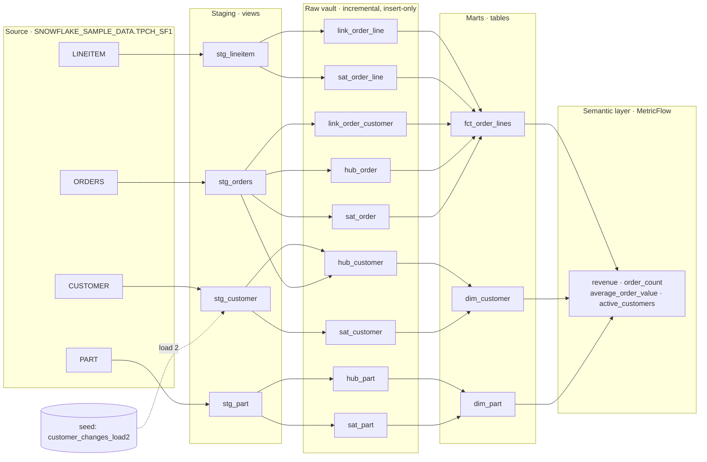

<!-- DRAFT README. Before publishing: rewrite "Design decisions" and "Trade-offs" in your own words, add screenshots, delete this comment. -->
# Data Vault → Star Schema → Semantic Layer (dbt + Snowflake)

A small, end-to-end demo of a layered analytics architecture: staging → **Data Vault 2.0** raw vault → **dimensional** marts → **MetricFlow** semantic layer with governed metrics.

> **What this is:** a hands-on portfolio project I wrote myself to show I can work in code, not just design on a whiteboard.
> **What this isn't:** production experience. It runs on public sample data, one source, two simulated loads. In my real roles I architected these patterns and engineering teams built and operated them. The "What production would add" section is the honest gap list.

## Architecture



| Layer | Purpose | Materialization |
|---|---|---|
| Staging | Rename, type, hash keys, hashdiffs, load metadata | view |
| Raw vault | Integrate by business key; keep full, auditable history | incremental (insert-only) |
| Marts | Easy-to-query star schema for BI | table |
| Semantic | Define each metric once; every tool gets the same number | YAML (MetricFlow) |

## Data

TPC-H scale factor 1, which ships with every Snowflake account. Orders are limited to calendar 1997 (vars in `dbt_project.yml`) to keep runs fast and cheap.

To show history, the project simulates **two loads**. Load 2 applies `seeds/customer_changes_load2.csv`, which changes the market segment, phone, or balance of customers 1–5. The satellites should pick up exactly those changes and nothing else.

## Design decisions

1. **Why a vault in the middle at all.** The vault separates *integrating and keeping history* from *presenting data*. New sources attach to existing hubs without remodeling, and every row is traceable to its source and load. The marts stay simple because the vault absorbs change.
2. **Hash keys.** Computed from standardized business keys (cast, trim, upper, null-safe, delimited — see `macros/hash_key.sql`). They are deterministic, so every source and every load produce the same key with no lookups, and loads can run in parallel. MD5 is used for readability; SHA-256 would be the production choice.
3. **Hashdiff change detection.** Each satellite stores a hash of its descriptive columns. A new satellite row is inserted only when the incoming hashdiff differs from the latest one held for that key. Unchanged data costs nothing.
4. **hub_customer has two feeders.** A customer key appears in both CUSTOMER and ORDERS. The hub takes keys from both, so an order can never reference a customer the hub doesn't know.
5. **Order line = link + link satellite.** A line item is a relationship (order ↔ part) that carries attributes (quantity, price, discount). `line_number` is a dependent child key: it is part of the link's hash but has no hub of its own.
6. **Marts read the current satellite row.** `dim_customer` is a type 1 (current-value) view. History stays in `sat_customer`; a type 2 dimension could be built from the same satellite without touching ingestion.
7. **Facts are additive only.** `fct_order_lines` stores quantity and revenue. Average order value is *not* stored, because a stored average can't be re-aggregated correctly.
8. **Metrics live in the semantic layer.** `average_order_value` is a ratio metric (revenue ÷ order_count) computed at query time, so it is right at any grain: month, segment, or both. This is the business-glossary idea ("here is how revenue is calculated") made executable.
9. **Types are pinned where data enters.** The load-2 seed declares column types to match the source. If a balance arrived as FLOAT instead of NUMBER(12,2), `0.00` would hash differently from `0`, and every customer would get a false "change." Hashdiffs are only as stable as the types feeding them.

## Trade-offs (said out loud)

- **A vault is overkill for one static source.** Here it demonstrates the pattern. For a single source with no history requirements, staging → star would be the right call.
- **No PIT or bridge tables.** Marts find the current satellite row with a window function. At scale, point-in-time tables would replace those repeated window scans.
- **Hash keys as dimension surrogate keys.** Convenient and stable, but 32-character strings are wider than integers for joins.
- **Simulated loads.** `load_date` comes from a variable, not a real ingestion timestamp.
- **Semantic layer runs locally.** MetricFlow via the `mf` CLI compiles and runs metric queries; a hosted semantic layer API (for BI tools to call) is not part of this.

## What production would add

Multiple real sources and a business vault · PIT/bridge tables · real ingestion timestamps and late-arriving data handling · orchestration and alerting · CI that runs `dbt build` against a dev warehouse on every PR · data contracts on sources · access control and masking policies · a semantic layer exposed to BI tools.

## Tests

- `unique` + `not_null` on every hash key
- `relationships` from every link and satellite back to its hubs, and from the fact to its dimensions
- `accepted_values` on order status and market segment
- one row per key per load date in every satellite
- `tests/assert_revenue_reconciles.sql`: total revenue in the fact equals total revenue computed straight from source

## Run it

**Setup (once)**
```bash
# 1. Key pair for the dbt service user
mkdir -p ~/.snowflake
openssl genrsa 2048 | openssl pkcs8 -topk8 -inform PEM -out ~/.snowflake/dbt_svc_key.p8 -nocrypt
openssl rsa -in ~/.snowflake/dbt_svc_key.p8 -pubout | grep -v "PUBLIC KEY" | tr -d '\n'; echo
# 2. Paste that public key into setup/snowflake_setup.sql, run it in Snowsight as ACCOUNTADMIN
# 3. Python env
python3 -m venv .venv && source .venv/bin/activate
pip install -r requirements.txt
cp .env.example .env   # fill in SNOWFLAKE_ACCOUNT
set -a; source .env; set +a
dbt debug
```

**Load 1, then load 2**
```bash
dbt seed
dbt build --vars '{load_batch: 1}'
dbt build --vars '{load_batch: 2}'     # satellites pick up the 5 changed customers
```
Then run `docs/verify.sql` in Snowsight.

**Query metrics**
```bash
mf list metrics
mf query --metrics revenue,order_count,average_order_value --group-by metric_time__month --order metric_time__month
mf query --metrics revenue,active_customers --group-by customer__market_segment
mf query --metrics average_order_value --group-by metric_time__quarter --explain   # see the generated SQL
```

**Docs**
```bash
dbt docs generate && dbt docs serve
```

**Rebuild from scratch:** `dbt build --full-refresh --vars '{load_batch: 1}'`

## Screenshots

_Add after running: `docs/img/lineage.png` (dbt docs lineage graph), `docs/img/sat_history.png` (verify query 1), `docs/img/mf_query.png` (a metric query result)._
